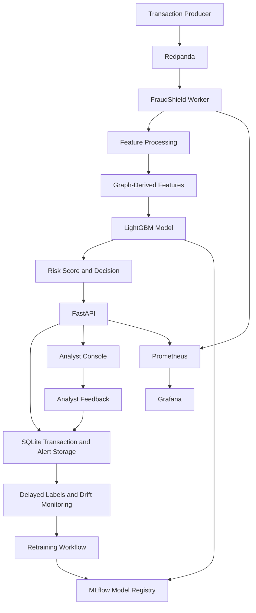

# FraudShield — Streaming Fraud Detection Platform

FraudShield is an end-to-end streaming fraud-detection prototype designed to score financial transactions, identify potentially fraudulent activity, generate analyst alerts, and monitor model performance and data drift over time.

The project combines machine learning, graph-derived features, event streaming, model registry integration, delayed-label monitoring, and observability into a Docker Compose-based system.

> **Project status:** Working local prototype  
> **Data scope:** Core experiments use synthetic data  
> **Production status:** Not production-certified

---

## Table of Contents

- [Overview](#overview)
- [Key Features](#key-features)
- [Architecture](#architecture)
- [Technology Stack](#technology-stack)
- [Transaction Workflow](#transaction-workflow)
- [Model Performance](#model-performance)
- [Graph Feature Ablation](#graph-feature-ablation)
- [Drift Detection and Retraining](#drift-detection-and-retraining)
- [Performance Testing](#performance-testing)
- [API Endpoints](#api-endpoints)
- [Getting Started](#getting-started)
- [Monitoring](#monitoring)
- [Testing](#testing)
- [Project Structure](#project-structure)
- [Limitations and Future Work](#limitations-and-future-work)
- [Documentation](#documentation)

---

## Overview

FraudShield demonstrates how a fraud-detection model can be deployed and operated as part of a streaming transaction system.

Rather than focusing only on model training, the project includes the surrounding infrastructure needed to serve predictions, store transaction and alert information, support analyst feedback, track models, and monitor changes in transaction data.

### Core capabilities

- Machine-learning-based transaction fraud scoring
- Streaming transaction processing with Redpanda
- FastAPI prediction and monitoring endpoints
- Graph-derived features for transaction risk
- Alert retrieval and analyst feedback routes
- SQLite-based transaction and alert persistence
- MLflow experiment tracking and model registry
- Delayed-label monitoring
- Population Stability Index (PSI)-based drift detection
- Retraining experiments
- Prometheus metrics and Grafana dashboards
- Docker Compose deployment
- Automated tests and reproducible experiment reports

---

## Key Features

### 1. Transaction Risk Scoring

FraudShield accepts transaction data and generates a fraud-risk score using the currently registered model.

The API returns information such as:

- Transaction ID
- Fraud-risk score
- Decision
- Decision threshold
- Model version
- Latency breakdown
- Risk explanation
- Graph-related context

### 2. Graph-Derived Fraud Features

The system incorporates graph-derived information to represent relationships between accounts, devices, and merchants.

These features help capture relationship-based patterns that may not be visible through transaction-level tabular features alone.

### 3. Analyst Alert Workflow

FraudShield provides endpoints for retrieving alerts and submitting analyst feedback.

The backend supports alert and feedback workflows, although the complete analyst-console workflow has not yet been fully manually validated.

### 4. Model Registry and Promotion

MLflow is used for experiment tracking and model registry integration.

A LightGBM candidate was evaluated against the existing champion and promoted through the model promotion gate.

### 5. Drift Monitoring

The project includes drift monitoring using PSI-based checks and delayed-label performance monitoring.

The drift experiments examine whether distribution changes can be detected before performance degradation becomes visible through matured labels.

### 6. Observability

Prometheus collects application and worker metrics, while Grafana provides dashboards for monitoring system behavior.

---

## Architecture



### Services

| Component | Purpose | Port |
|---|---|---:|
| FastAPI | Scoring, alerts, feedback, model information, drift, retraining | `8000` |
| Redpanda | Transaction-event streaming | `19092` |
| Worker | Event processing and worker metrics | `9100` |
| MLflow | Experiment tracking and model registry | `5000` |
| Prometheus | Metrics collection | `9090` |
| Grafana | Monitoring dashboards | `3000` |
| SQLite | Transaction and alert storage | `data/fraudshield.db` |

Application data is persisted through a Docker volume.

---

## Technology Stack

| Category | Technologies |
|---|---|
| Backend | Python, FastAPI |
| Machine Learning | LightGBM, scikit-learn |
| Graph Features | NetworkX and graph-derived feature engineering |
| Event Streaming | Redpanda |
| Database | SQLite |
| Experiment Tracking | MLflow |
| Model Registry | MLflow Model Registry |
| Monitoring | Prometheus |
| Dashboards | Grafana |
| Frontend | React-based analyst console |
| Deployment | Docker, Docker Compose |
| Testing | pytest |

---

## Transaction Workflow

1. A transaction is generated or submitted.
2. The transaction enters the scoring pipeline.
3. Features are prepared, including graph-derived features.
4. The registered model generates a fraud-risk score.
5. The score is compared with the configured decision threshold.
6. The system returns a decision and supporting information.
7. Transaction and alert information is stored.
8. Analysts can review alerts and submit feedback.
9. Labels can mature after a delay.
10. Monitoring tracks service health, model behavior, and data drift.

---

## Model Performance

The final promoted model is LightGBM, loaded from the MLflow registry.

### Final model information

| Field | Value |
|---|---|
| Backend | LightGBM |
| Model version | `v20261104110057` |
| MLflow registry version | `4` |
| Model source | MLflow registry |
| Promotion | Successful |

### Evaluation split

| Dataset | Rows |
|---|---:|
| Training | 27,664 |
| Validation | 5,700 |
| Test | 6,000 |
| Fraud cases in test set | 220 |

The data split was chronological.

### LightGBM results

| Metric | Value |
|---|---:|
| Test PR-AUC | **0.8981** |
| Recall at 90% precision | 0.6955 |
| Precision at top 1% | 1.0000 |
| Precision at selected threshold | 0.6041 |
| Recall at selected threshold | 0.9364 |
| Selected threshold | 0.084937 |
| Validation cost at threshold | 6,060 |
| Flag-nothing cost | 110,000 |

### Logistic Regression Baseline

| Metric | Value |
|---|---:|
| PR-AUC | 0.7749 |
| Recall at 90% precision | 0.4227 |
| Precision at top 1% | 0.9500 |
| Cost | 15,620 |

The final LightGBM model outperformed the reported logistic regression baseline.

---

## Graph Feature Ablation

A controlled synthetic-data experiment compared tabular features with graph-derived features.

### Experiment setup

| Parameter | Value |
|---|---:|
| Total rows | 60,000 |
| Training rows | 41,694 |
| Validation rows | 8,677 |
| Test rows | 9,000 |
| Test frauds | 343 |
| Label delay | 4 hours |
| Seeds | 5 |

### Results

| Model | PR-AUC | Recall @ 90% precision | Precision @ top 1% | Cost |
|---|---:|---:|---:|---:|
| Logistic Regression, tabular | 0.8695 | 0.6327 | 0.9778 | 17,280 |
| GBM, tabular | 0.9254 | 0.7772 | 1.0000 | 12,252 |
| GBM, tabular + graph | **0.9485** | **0.8216** | 1.0000 | **7,724** |

### Reported graph-feature contribution

| Statistic | Value |
|---|---:|
| Paired bootstrap PR-AUC improvement | +0.0249 |
| Bootstrap resamples | 1,000 |
| 95% confidence interval | `[0.0100, 0.0403]` |
| Reported cost reduction | 36.9% |

Graph-derived features improved performance in this synthetic benchmark. The result requires validation on real-world datasets before generalizing beyond this experimental setting.

---

## Drift Detection and Retraining

The drift experiment evaluated PSI-based monitoring under synthetic distribution shift and delayed labels.

### Drift experiment setup

| Parameter | Value |
|---|---:|
| Base data | 40,000 rows |
| Live data | 24,000 rows |
| Drift onset | Row 8,000 |
| Drift ramp | 4,000 rows |
| Label delay | 4 hours |
| Features monitored | 9 |
| PSI window | 500 |
| Check interval | 100 |
| PSI threshold | 0.2 |
| Trigger condition | At least 2 drifted features |

### Detection timing

| Event | Row |
|---|---:|
| Drift onset | 8,000 |
| PSI trigger | 9,600 |
| Oracle performance drop | 9,800 |
| Matured-label performance drop | 10,100 |

The drift trigger occurred 500 transactions before matured-label performance-drop detection, corresponding to approximately 5.8 stream hours in the experiment.

### Drift-free control

| Measure | Value |
|---|---:|
| Pre-drift false-trigger checks | 0 |
| Drift-free control checks | 236 |
| Triggered checks | 15 |
| Trigger rate | 6.4% |

The drift-free control produced some triggers, so threshold calibration remains necessary.

### Retraining results

| Strategy | PR-AUC | Recall | Precision | Cost |
|---|---:|---:|---:|---:|
| No retrain | **0.8211** | 0.8200 | 0.3830 | 76,960 |
| Trigger retrain | 0.7400 | 0.8124 | 0.3076 | 86,180 |
| Retrain after 24h | 0.7600 | 0.8003 | 0.5317 | 75,320 |
| Retrain after 72h | 0.7566 | 0.7958 | 0.5964 | **74,620** |

**Finding:** The experiment did not demonstrate PR-AUC recovery through retraining. The 72-hour retraining scenario had slightly lower cost than no retraining, but its PR-AUC was lower.

---

## Performance Testing

### In-process benchmark

| Metric | Value |
|---|---:|
| Warm requests | 3,000 |
| p50 latency | 0.848 ms |
| p95 latency | 1.38 ms |
| p99 latency | 2.207 ms |
| Feature + graph p50 | 0.137 ms |
| Model + explanation p50 | 0.613 ms |
| SQLite p50 | 0.092 ms |
| Throughput | 596.8 transactions/sec |

The benchmark was performed in a single-threaded, 1-vCPU Linux container.

> **Benchmark scope:** These are in-process results, not a complete HTTP, Docker-networking, or Kafka end-to-end load test.

### HTTP load test

A 3,000-request HTTP load test was attempted but did not complete successfully. The API process encountered a `std::bad_alloc` error and exited with code `134`.

The exact root cause was not conclusively established. Therefore, no successful HTTP load-test result is reported.

---

## API Endpoints

| Method | Endpoint | Purpose |
|---|---|---|
| `GET` | `/api/health` | Service health and model version |
| `POST` | `/api/score` | Score a transaction |
| `GET` | `/api/alerts` | Retrieve alerts |
| `GET` | `/api/alerts/{transaction_id}` | Retrieve a specific alert |
| `POST` | `/api/alerts/{transaction_id}/feedback` | Submit analyst feedback |
| `GET` | `/api/summary` | Runtime summary |
| `GET` | `/api/drift` | Drift monitoring information |
| `GET` | `/api/model` | Model metadata and evaluation metrics |
| `POST` | `/api/retrain` | Trigger retraining workflow |
| `GET` | `/metrics` | Prometheus metrics |
| `GET` | `/docs` | OpenAPI documentation |

### Example health response

```json
{
  "status": "ok",
  "model_version": "v20261104110057",
  "backend": "lightgbm",
  "model_source": "mlflow-registry"
}
```

---

## Getting Started

### Prerequisites

- Python 3.11
- Docker Desktop
- Docker Compose
- Git

### Clone the repository

```bash
git clone https://github.com/RiyaPandey06/FraudShield.git
cd FraudShield
```

### Start the services

```bash
docker compose up -d --build
```

### Check running services

```bash
docker compose ps
```

### Check API health

```bash
curl http://localhost:8000/api/health
```

### Open the API documentation

```text
http://localhost:8000/docs
```

### Open the monitoring interfaces

| Service | URL |
|---|---|
| FastAPI | http://localhost:8000 |
| API documentation | http://localhost:8000/docs |
| MLflow | http://localhost:5000 |
| Prometheus | http://localhost:9090 |
| Grafana | http://localhost:3000 |

> The project was developed and validated locally using Docker Compose. Environment-specific configuration may be required before running it on another machine.

---

## Monitoring

### Prometheus

Prometheus collects application and worker metrics.

Readiness endpoint:

```text
http://localhost:9090/-/ready
```

Targets:

```text
http://localhost:9090/api/v1/targets
```

### Grafana

Grafana provides dashboards for:

- Model version in service
- Retraining runs
- Analyst feedback and matured labels
- Alert rate
- Drift PSI

### MLflow

MLflow provides experiment tracking and model registry integration. The final promoted model was confirmed to be loaded from the registry.

---

## Testing

Run the automated test suite:

```bash
python -m pytest -q
```

### Recorded test result

```text
28 passed, 34 warnings in 90.99s
```

| Result | Count |
|---|---:|
| Passed | 28 |
| Failed | 0 |
| Warnings | 34 |
| Duration | 90.99 seconds |

The warnings were deprecation-related and did not cause test failures.

---

## Project Structure

```text
FraudShield/
├── app/                    # FastAPI application and core services
├── experiments/             # Model, ablation, drift, and load-test experiments
├── static/                  # Analyst console frontend
├── tests/                   # Automated tests
├── docs/
│   ├── RESULTS.md            # Experiment results
│   ├── DEMO_SCRIPT.md        # Demo walkthrough
│   ├── INTERVIEW_PREP.md     # Project interview preparation
│   ├── RESUME_BULLETS.md     # Resume-ready project points
│   ├── architecture.md       # Architecture documentation
│   └── architecture.svg      # Architecture diagram
├── results/                  # Saved experiment outputs
├── monitoring/               # Monitoring configuration
├── Dockerfile
├── docker-compose.yml
├── pyproject.toml
├── README.md
└── MODEL_CARD.md
```

---

## Limitations and Future Work

FraudShield is a working prototype and demonstration system. The following work remains:

- Evaluate the model on real-world datasets such as IEEE-CIS or PaySim.
- Complete end-to-end analyst-console workflow validation.
- Conduct a real analyst review-time study.
- Investigate and stabilize the HTTP load-test failure.
- Calibrate drift thresholds to reduce false triggers.
- Improve the retraining strategy and evaluate recovery under drift.
- Expand graph-model experiments beyond the lightweight message-passing implementation.
- Validate the complete streaming pipeline under sustained load.
- Conduct broader deployment and security testing before any production use.

---

## Documentation

Additional project documentation is available in the repository:

- `MODEL_CARD.md` — model information and intended scope
- `docs/RESULTS.md` — detailed experiment results
- `docs/DEMO_SCRIPT.md` — demo walkthrough
- `docs/INTERVIEW_PREP.md` — project explanation and interview preparation
- `docs/RESUME_BULLETS.md` — resume-ready project points
- `docs/architecture.md` — architecture details
- `docs/architecture.svg` — architecture diagram

---

## Project Status

| Area | Status |
|---|---|
| FastAPI backend | Implemented and health-checked |
| Transaction scoring | Verified |
| LightGBM model | Promoted and live |
| MLflow registry | Verified |
| Redpanda streaming | Included in Compose stack |
| Graph-derived features | Evaluated |
| Alert and feedback routes | Implemented |
| Drift monitoring | Implemented and experimentally evaluated |
| Retraining experiment | Completed; results mixed |
| Prometheus | Health-checked |
| Grafana | Dashboard inspected |
| Automated tests | 28 passed |
| In-process benchmark | Completed |
| HTTP load test | Attempted; unsuccessful |
| Real-world dataset evaluation | Pending |
| Full analyst UI workflow | Pending |
| Production certification | Not completed |

---

## Conclusion

FraudShield demonstrates an end-to-end fraud-detection prototype integrating machine learning, streaming infrastructure, graph-derived features, model registry management, drift monitoring, analyst workflows, and observability.

The final promoted LightGBM model achieved **0.8981 PR-AUC** on its reported test split. In a separate synthetic ablation, graph-derived features reached **0.9485 PR-AUC** and reduced reported cost by **36.9%**. The drift experiment detected a distribution change before matured-label performance-drop detection, while the retraining experiment highlighted that retraining does not automatically improve model performance.

The project is intended as a demonstrable engineering and research prototype. Real-world dataset validation, complete frontend workflow verification, and successful end-to-end HTTP load testing remain future work.

**Repository:** [RiyaPandey06/FraudShield](https://github.com/RiyaPandey06/FraudShield)
