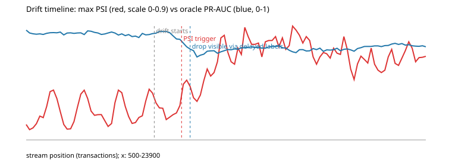

# FraudShield results

Generated 2026-11-04 11:24 UTC by `python -m experiments.run_all`.

> **Read this first.** All numbers below come from the **synthetic** generator (`app/synthetic.py`), whose fraud
> patterns (rings, stealth rings, account takeover, drift) were injected by the author. They demonstrate the
> *method and the measurement discipline*, not real-world fraud performance. Model backend for this run:
> **lightgbm** (LightGBM + exact TreeSHAP).
> Re-run on your machine to regenerate with LightGBM.

## 1. Detection quality and graph ablation

Strict chronological 70/15/15 split with a 4h label-maturity embargo. 41,694 train /
8,677 validation / 9,000 test rows; **343 frauds in the test window**. Cost uses
missed-fraud = 500 and false-positive = 20; thresholds are tuned on validation only. Accuracy is never reported.

| Model | PR-AUC | Recall @ 90% precision | Precision @ top 1% | Total cost @ tuned threshold |
|---|---|---|---|---|
| Logistic regression (tabular) | 0.870 | 0.633 | 0.978 | 17,280 |
| GBM tabular only (mean of seeds) | 0.925 | 0.777 | 1.000 | 12,252 |
| GBM tabular + graph (mean of seeds) | 0.949 | 0.822 | 1.000 | 7,724 |

Flagging nothing would cost 171,500. GBM seed spread (std over 5 seeds): PR-AUC tabular
0.0005, tabular+graph 0.0014.

**Graph features vs tabular only** (paired bootstrap over test rows, 1000 resamples, seed 0, 95% CI):

| Metric | Tabular | + Graph | Difference (CI) |
|---|---|---|---|
| PR-AUC | 0.925 | 0.950 | +0.025 [+0.010, +0.040] |
| Recall @ 90% precision | 0.773 | 0.828 | +0.052 [-0.005, +0.108] |
| Precision @ top 1% | 1.000 | 1.000 | +0.000 [+0.000, +0.000] |

Precision@1% is saturated near 1.0 for both models, so it cannot discriminate them here; PR-AUC and recall at fixed
precision are the informative metrics. Recall at each model's own cost threshold, by fraud scenario:

| Scenario | Frauds in test | Tabular | + Graph |
|---|---|---|---|
| solo | 202 | 0.990 | 0.990 |
| ring | 95 | 0.947 | 0.979 |
| stealth | 46 | 0.913 | 0.957 |

Gains appear on every scenario and are largest for the two device-sharing ring scenarios (ring, stealth), which is what
the generator was built to produce: ring behaviour depends on shared devices and delayed confirmed labels. Per-scenario
counts are small (46 stealth frauds), so treat the per-scenario figures as indicative. On real data the gain could be
larger, smaller or zero.

## 2. Latency and throughput (in-process, 3,000 requests after warm-up)

| Stage | p50 ms | p95 ms | p99 ms |
|---|---|---|---|
| End to end (features + model + SQLite) | 0.848 | 1.38 | 2.207 |
| Feature + graph context | 0.137 | 0.229 | 0.322 |
| Model + reasons (occlusion) | 0.613 | 0.98 | 1.127 |
| SQLite write | 0.092 | 0.175 | 0.466 |

Throughput: **596.8 tx/s** single-threaded on 1 vCPU (Linux-6.18.44-fc-v185-x86_64-with-glibc2.39).
This excludes HTTP and Kafka overhead; run `python -m experiments.loadtest --mode http` against the running stack for
client-side numbers on your hardware. The occlusion explainer costs more than exact TreeSHAP will with LightGBM.

## 3. Drift detection

Setup: model trained on 40,000 rows, then a 24,000-row live stream where gradual covariate drift
(inflating amounts, unseen countries) and concept drift (a new low-and-slow tactic) start at row 8,000
and reach full strength 4,000 rows later. Monitor: PSI on 9 inputs and the score, 500-row window,
check every 100 rows, trigger when at least 2 signals exceed PSI 0.2.

| Event | Stream row |
|---|---|
| Drift starts | 8,000 |
| PSI retraining trigger (label-free) | 9,600 (features: country_new, risk_score) |
| PR-AUC drop with *instant* labels (unrealistic oracle) | 9,800 |
| PR-AUC drop visible with *matured* labels only | 10,100 |

**Lead time of the PSI trigger over label-based detection: 500 transactions
(~5.8 h of stream time).** Against the unrealistic instant-label oracle the lead is only
200 transactions. False alarms: 0 triggered checks before drift started, and
15 of 236 checks on a drift-free control stream (the control's single-feature PSI peaked at
0.6742, which is why the trigger requires at least two drifting signals).

Honest reading: the monitor fired *1,600 transactions after drift began* (the shift is gradual and PSI needs a
window to see it), and its advantage over label-based monitoring is real but modest with a 4h label delay.
Real card-fraud label delays are days to weeks, so the lead should be larger there, but that is an expectation, not something this experiment tested. Timeline chart: `results/drift_timeline.svg`.

### Does retraining help?

Evaluated on the final 6,000 fully-drifted transactions; retraining uses base history plus live rows whose labels had matured.

| Strategy | PR-AUC | Recall @ thr | Precision @ thr | Total cost | Live labelled rows used |
|---|---|---|---|---|---|
| no_retrain | 0.821 | 0.820 | 0.383 | 76,960 | - |
| retrain_at_trigger | 0.740 | 0.812 | 0.308 | 86,180 | 9289 |
| retrain_trigger_plus_24h | 0.760 | 0.800 | 0.532 | 75,320 | 11291 |
| retrain_trigger_plus_72h | 0.757 | 0.796 | 0.596 | 74,620 | 15377 |

Retraining on the drifted data did **not** materially recover performance in this experiment. One untested hypothesis is that
the generated low-and-slow fraud is hard to separate with the current features, so more labels alone do not help and new
features would be needed. Whatever the cause, this is a real limitation of the retraining path as built, not a success
to claim: the drift trigger gives warning, but this experiment shows no recovery from retraining.
The promotion gate (candidate must not be worse than the champion on the new test window) is exercised in the unit tests.

## 5. Graph neural comparison (FR-13, optional)

PyTorch Geometric was not available, so this is a transparent numpy/scikit-learn **two-layer message-passing network**
(`experiments/gnn.py`): label-free mean aggregation of neighbouring accounts' latest tabular features over the
account-device graph (<=25 neighbours, causal), then an MLP. It is *not* a PyG model. Same strict time split and label embargo;
mean over 3 seeds; 343 test frauds.

| Model | PR-AUC (mean ± std) | Recall @ 90% precision | Cost @ tuned threshold |
|---|---|---|---|
| GBM tabular | 0.910 ± 0.001 | 0.731 | 12,153 |
| GBM tabular + graph features | 0.939 ± 0.002 | 0.808 | 7,367 |
| GBM tabular + message-passing features | 0.918 ± 0.005 | 0.723 | 10,547 |
| Message-passing neural net (MLP) | 0.868 ± 0.008 | 0.614 | 13,707 |

Paired bootstrap (500 resamples, 95% CI), message-passing net minus baseline, PR-AUC:
vs GBM tabular **-0.036 [-0.060, -0.011]**; vs GBM tabular + graph features **-0.065 [-0.089, -0.040]**.

**Result: the neural message-passing model lost to the strong tabular baseline, and clearly lost to the graph-feature GBM.**
The PRD requires a loss to be reported, so it is. Feeding the same message-passing features to a GBM recovers only a small
PR-AUC change over tabular alone, so on this data the *hand-built* graph features (shared-device counts, matured fraud
risk, communities) carry the signal and label-free neighbour averaging does not. Caveats: one dataset (synthetic), one
architecture, no tuning beyond defaults; a tuned PyG GNN could do better, and that is not tested here.

## 6. Not measured here

* **Review-time reduction from LLM explanations.** Needs real people. The dashboard records time-to-label per case under random
  assignment of an explanation-on/off arm; `python -m experiments.review_time_report` turns those recordings into a percent
  change with a CI. Until someone runs the study, the resume bullet for this stays unfilled.
* **Real datasets.** IEEE-CIS and PaySim loaders exist and are fixture-tested but could not be downloaded in the build environment.
* **PyG-based GNN.** Only a numpy/scikit-learn message-passing network was built (section 5); a PyTorch Geometric model was not.
