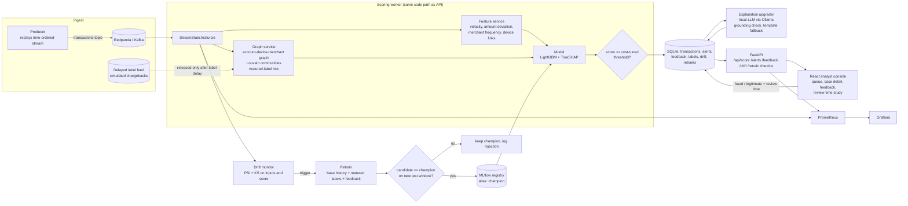

# Architecture

## Design decisions that matter

* **One feature code path.** `app/pipeline.py::StreamState` is used by training, the experiments, the worker and the API.
  `tests/test_core.py::test_train_serve_parity` proves the live service reproduces the training features exactly.
* **Labels are delayed everywhere.** `GraphService.schedule_label` reveals a label only after `LABEL_DELAY_HOURS`. Training
  purges rows whose labels would not yet be mature at the split boundary (embargo). The earlier version of this project
  fed true labels into the graph instantly in training but used its own alerts when serving, which is leakage plus
  train/serve skew; both are fixed.
* **Strict time splits.** 70/15/15 chronological, never random. Retraining sorts base + live rows by timestamp before splitting.
* **Safe retraining.** A candidate is promoted only if its PR-AUC on the new chronological test window is not below the
  current champion's. Retraining is deferred until enough matured labels exist.
* **Explanations never block scoring.** Every alert gets raw top-3 contributions and a template sentence immediately;
  the LLM rewrite is asynchronous and accepted only if every number it states appears in the supplied facts.
* **Backends.** LightGBM with exact TreeSHAP is the production path. If LightGBM cannot be imported the code falls back to
  scikit-learn HistGradientBoosting with *occlusion* attributions, recorded as `explainer: occlusion` (these are not SHAP values).
